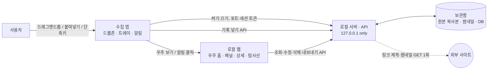
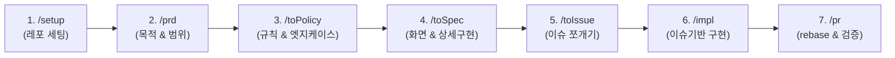

# 🌌 SpaceLog

> 흩어진 기록을 모아 나만의 우주로 다시 만나는 로컬 퍼스널 아카이브

맥·윈도우의 아주 가벼운 **수집 앱**으로 드래그앤드롭 한 번에 기록을 모으고, **로컬 웹의 우주**에서 한눈에 보고 둘러보며 다시 만나고, 고른 묶음을 **Claude용으로 내보낸다.**

- 수집 앱은 **모으기만**, 보기·정리·내보내기는 앱이 내 PC에 띄우는 **로컬 웹**이 맡는다.
- 기록은 **내 PC에만** 저장된다. 로그인·클라우드·텔레메트리가 없다.

> **상태**: 기획 1차 초안 (2026-11-11) · 사용자 인터뷰 후 2차 개정 예정 · 구현 전

---

## 🤔 왜 만드나

다운로드 폴더, 캡처, 카톡 나와의 채팅, 메모앱에 흩어 저장하기만 하고 **다시 보게 하는 장치가 없다.** 그래서 모아둔 자료와 생각이 묻히고 잊힌다.

| 근거 | 출처 |
| --- | --- |
| 사용자는 디지털로 저장한 콘텐츠를 거의 다시 보지 않는다 | Schneegass 외 2021 (N=58) |
| 찍은 사진의 70%는 다시 보지 않는다 | Popsa 2026 |
| 알림을 받으면 저장한 콘텐츠를 다시 본다 → 재발견 장치를 핵심 기능으로 | Sigethy 외 2025 |
| 사람들은 평범한 과거 기록을 다시 보는 즐거움을 과소평가한다 | Zhang 외 2014 |

자세한 근거와 공백은 [docs/RESEARCH.md](docs/RESEARCH.md) 참고.

**타깃(가정)**: PC로 일하거나 공부하며 하루에도 캡처, 문서, 링크, 메모를 많이 접하는 20~30대. 연령은 인터뷰로 확인 예정이다.

---

## ✨ 핵심 기능 (MVP)

가장 중요한 두 축은 **모으기(수집 앱)** 와 **다시 만나기(재발견)** 다.

| 기능 | 어디서 | 내용 |
| --- | --- | --- |
| 🧲 **수집 앱** | 맥·윈도우 | 화면 가장자리의 작은 드롭존에 이미지·파일·링크·텍스트를 끌어다 놓거나 붙여넣기. 전역 단축키로 클립보드 즉시 저장. 넣은 직후 배정된 행성 확인·한 줄 메모 |
| 🔁 **재발견** | 수집 앱 알림 + 웹 카드 | 하루 한 번 "7일 전 오늘의 별" 알림. 누르면 우주에서 그 별이 있는 행성으로 이동한다 |
| 🪐 **우주** | 로컬 웹 | 기간(오늘 / 이번 주 / 직접 지정)의 우주 전체를 한눈에 조망. 행성 목록에서 바로 가기, 행성 클릭으로 들어가기. 표현 방식(3D안 비행 / 2.5D안 확대·이동)은 Q7에서 정한다 |
| 🗂️ **행성 패널 · 별 상세** | 로컬 웹 | 별 목록, 행성 이름 변경·생성·삭제·합치기, 원본 미리보기·열기, 메모 수정, 행성 옮기기 |
| 🚀 **탐사선** | 로컬 웹 | 고른 별·행성·우주를 Claude 프롬프트 형식 또는 MCP 리소스 형식으로 만들어 **미리보기 후 복사** (보조 기능, 수요 검증 대상) |

### 용어

| 용어 | 뜻 |
| --- | --- |
| 기록 / 별 | 사용자가 넣은 자료 1개 (문서에서는 "기록", 화면에서는 "별") |
| 행성 | 기록을 묶는 카테고리 |
| 우주 | 로컬 웹에서 행성과 별을 보여주는 화면. 3D안 / 2.5D안 시안을 비교 중 (Q7) |
| 재발견 | 지난 기록 하나를 골라 다시 보여주는 기능 |
| 탐사선 | 고른 기록을 Claude가 읽기 좋은 형식으로 내보내는 기능 |

### 이번에 하지 않는 것

웹에서 새 기록 만들기 · 외부 AI 자동 분류 · 검색/태그 · 원본 파일 편집 · 로그인/클라우드 동기화/백업 · 모바일 · 공유/협업 · MCP 서버 직접 조회 · Claude 자동 전송 · 자동 백그라운드 수집

---

## 🏗️ 구조



**보안·데이터 원칙** ([docs/POLICY.md](docs/POLICY.md))
- 밖으로 나가는 요청은 링크 제목·썸네일 가져오기(GET 1회) 하나뿐이다.
- 로컬 서버는 `127.0.0.1`에만 바인딩하고, Host·Origin 검사와 실행마다 새로 만드는 세션 토큰으로 다른 웹페이지의 호출을 막는다.
- 원본은 보관함에 **복사**해 저장하고, 사용자의 원래 파일은 건드리지 않는다.
- 탐사선 내보내기에는 절대 경로를 넣지 않는다.

### 기술 스택 (결정 중)

| 영역 | 후보 | 상태 |
| --- | --- | --- |
| 수집 앱 + 로컬 서버 (Q3) | **Electron + TypeScript 서버** 제안 ([ADR 0001](docs/adr/0001-collector-server-stack.md)) | 윈도우 스파이크 측정 완료, 맥 측정과 개발 B 확인 후 채택 |
| 웹 + 우주 렌더링 (Q9) | Vite + Three.js (가정, 3D안·2.5D안 모두 가능) | 개발 B·C, Q7 결정 후 |

### 폴더 구성 (SPEC 제안, 잠정)

```
apps/collector/     # 수집 앱 (PO)
apps/server/        # 로컬 서버·API·보관함 (개발 B)
web/                # 로컬 웹: universe · home · planet · star · probe
packages/shared/    # 공용 타입, 오류 코드, 기간 유틸
mocks/api/          # 1일 차 API 목업
docs/               # 기획 문서
```

---

## 👥 팀과 피처 오너십

한 사람당 빅 피처 하나를 처음부터 끝까지 맡는다.

| 오너 | 빅 피처 |
| --- | --- |
| PO | 수집 앱 + 검증 (인터뷰, 성공 기준, 데모) |
| 개발 A · 박기석 | 재발견 + 탐사선 |
| 개발 B · 이영섭 | 보관함 + 로컬 서버·API + 행성 패널·별 상세 |
| 개발 C · 한가영 | 우주 + 우주 홈 |
| 디자이너 · 전현우 | 3D안 시안 → 공통 디자인 문서 |
| 디자이너 · 신선이 | 2.5D안 시안 → 공통 디자인 문서 |

화면 디자인 분담은 두 시안을 비교해 합친 공통 디자인 문서(`docs/DESIGN.md` 제안)가 나온 뒤 정한다 (PRD 6장).

### 성공 기준

| 기준 | 목표 |
| --- | --- |
| 모으기가 빠르다 | 드롭 → 저장 완료 3초 이내 |
| 한눈에 보인다 | 웹 첫 화면에서 조작 0회로 기간의 행성 전체가 보임 |
| 클릭만으로 찾는다 | 우주 홈 → 원하는 행성 패널까지 클릭 2회 이내 |
| 다시 만난다 (핵심) | 재발견 알림·카드를 연 비율 (인터뷰 후 확정) |
| 내보내기가 빠르다 | 탐사선 열기 → 복사 완료 1분 이내 |

---

## 📁 문서 위치

| 문서 | 내용 |
| --- | --- |
| [docs/RESEARCH.md](docs/RESEARCH.md) | 문제정의 근거 리서치 |
| [docs/PRD.md](docs/PRD.md) | 기획서: 문제, 목표, 범위, 저니, 오너십, 열린 질문 |
| [docs/POLICY.md](docs/POLICY.md) | 정책서: 보안, 비즈니스 규칙, 예외 처리 |
| [docs/SPEC.md](docs/SPEC.md) | 스펙서: 화면, 데이터 모델, API, 흐름, 폴더 구성 |
| [docs/adr/](docs/adr/) | 기술 결정 기록 (0001: 수집 앱·서버 스택) |
| [docs/INTERVIEW.md](docs/INTERVIEW.md) | 사용자 인터뷰 가이드: 대상, 질문, 판정 기준 |
| [docs/DEMO.md](docs/DEMO.md) | 데모 시나리오, 인수 기준, 성공 기준 측정 방법 |
| [GitHub Issues](https://github.com/delightPIP/teamproject/issues) | 작업 이슈 #1~#10 (이슈 1개 = 빅 피처 1개) |

---

## 📌 팀 협업 파이프라인
1. `/setup` ➔ 2. `/prd` ➔ 3. `/toPolicy` ➔ 4. `/toSpec` ➔ 5. `/toIssue` ➔ 6. `/impl` ➔ 7. `/pr`

현재 5단계(`/toIssue`)까지 끝났다. 이슈 #1~#10이 등록되어 있고, 다음은 각자 이슈를 받아 `/impl`로 구현한다. 1일 차에 먼저 끝내야 하는 것은 #1 공통 타입·API 목업(개발 B)과 Q3 스택 확정(PO·개발 B)이다.

## 🛡️ Git 3대 수칙 (충돌 방지 자동화)
1. **브랜치 시작 전**: 항상 최신 main 당겨오기
   ```bash
   git checkout main && git pull origin main
   git checkout -b feat/#이슈번호-작업명
   ```
2. **PR 올리기 전**: 최신 main으로 rebase하기 (미리베이스 시 Git Push 자동 차단)
   ```bash
   git fetch origin && git rebase origin/main
   ```
3. **머지 조건**: 작성자 외 팀원 1명 이상의 Approve(승인) 필수.

> 클론한 뒤 한 번만 아래 명령으로 리베이스 검사 훅을 켠다.
> ```bash
> git config core.hooksPath .githooks
> ```

---

## 🧰 협업 스킬 팩 (Team Rules)

### 워크플로우



### 스킬 안내

| 단계 | 명령어 | 역할 | 설명 |
| :---: | :--- | :--- | :--- |
| **1** | **`/setup [프로젝트명]`** | 레포지토리 초기화 | 오늘 과제 뼈대 + `README.md` + `docs/` 폴더 + 리베이스 강제 Git 훅 자동 세팅 |
| **2** | **`/prd [아이디어]`** | 제품 요구사항 정의 | 해결할 문제, 타깃 유저, MVP 필수 범위(In/Out Scope) 정의 |
| **3** | **`/toPolicy`** | 정책 및 규칙 수립 | PRD를 바탕으로 보안, 데이터, 비즈니스 계산 공식, 예외 처리 규칙 도출 |
| **4** | **`/toSpec`** | 상세 구현 명세 | 정책과 PRD를 결합하여 화면 레이아웃, 데이터 모델, 상태 흐름 명세화 |
| **5** | **`/toIssue`** | 작업 이슈 등록 | 스펙(또는 PRD 단독)을 기반으로 GitHub Issues에 티켓 자동 등록 (로컬 파일 미생성) |
| **6** | **`/impl [이슈]`** | 이슈 기반 구현 | 브랜치 확인 후 `POLICY`와 `SPEC`을 준수하며 대상 코드 구현 및 자체 검증 |
| **7** | **`/pr`** | PR 검증 및 생성 | `main` rebase 여부 확인, 충돌 검증, 팀원 1명 승인용 PR 본문 생성 |

### 설치 및 등록

수동으로 폴더를 찾아서 복사할 필요 없이, **현재 사용 중인 AI 에이전트(Cursor, Claude Code, Windsurf, Copilot 등) 채팅창에 아래 문장을 그대로 입력**하면 AI가 알아서 설치하고 등록합니다.

#### 🤖 AI 에이전트에게 설치 시키기 (채팅창에 붙여넣기)

```text
https://github.com/delightPIP/teamproject 저장소의 skills/ 폴더에 있는 스킬들을 내 AI 에이전트 전역 스킬(또는 현재 워크스페이스 스킬)로 등록해 줘.
앞으로 내가 /setup, /prd, /toPolicy, /toSpec, /toIssue, /impl, /pr 명령어를 입력하면 해당 스킬의 SKILL.md 지침에 따라 동작하도록 설정해 줘.
```

*(선택: 터미널 환경에서 CLI 도구를 쓸 경우 `npx skills add delightPIP/teamproject` 로도 설치 가능)*

### 매일 새 과제 레포에서의 사용 흐름

1. 빈 과제 폴더에서 AI 채팅창에 `/setup [오늘 과제명]` 실행
2. 회의하며 화면 띄우고: `/prd` ➔ `/toPolicy` ➔ `/toSpec` ➔ `/toIssue` *(단순 과제는 `/prd` ➔ `/toIssue` 직행 가능)*
3. 각자 이슈를 할당받은 뒤:
   ```bash
   git checkout main && git pull origin main
   git checkout -b feat/#이슈번호-기능명
   ```
4. 코딩 시: `/impl #이슈번호` 실행하여 정책과 스펙을 지키며 구현
5. 작업 완료 시: `/pr` 실행하여 rebase 검사 후 PR 등록
