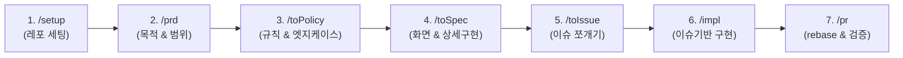

# 🚀 Team Rules (협업 스킬 팩)

---

## 📌 워크플로우



---

## 🛠️ 스킬 안내

| 단계 | 명령어 | 역할 | 설명 |
| :---: | :--- | :--- | :--- |
| **1** | **`/setup [프로젝트명]`** | 레포지토리 초기화 | 오늘 과제 뼈대 + `README.md` + `docs/` 폴더 + 리베이스 강제 Git 훅 자동 세팅 |
| **2** | **`/prd [아이디어]`** | 제품 요구사항 정의 | 해결할 문제, 타깃 유저, MVP 필수 범위(In/Out Scope) 정의 |
| **3** | **`/toPolicy`** | 정책 및 규칙 수립 | PRD를 바탕으로 보안, 데이터, 비즈니스 계산 공식, 예외 처리 규칙 도출 |
| **4** | **`/toSpec`** | 상세 구현 명세 | 정책과 PRD를 결합하여 화면 레이아웃, 데이터 모델, 상태 흐름 명세화 |
| **5** | **`/toIssue`** | 작업 이슈 등록 | 스펙(또는 PRD 단독)을 기반으로 GitHub Issues에 티켓 자동 등록 (로컬 파일 미생성) |
| **6** | **`/impl [이슈]`** | 이슈 기반 구현 | 브랜치 확인 후 `POLICY`와 `SPEC`을 준수하며 대상 코드 구현 및 자체 검증 |
| **7** | **`/pr`** | PR 검증 및 생성 | `main` rebase 여부 확인, 충돌 검증, 팀원 1명 승인용 PR 본문 생성 |

---

## 📦 설치 및 등록

수동으로 폴더를 찾아서 복사할 필요 없이, **현재 사용 중인 AI 에이전트(Cursor, Claude Code, Windsurf, Copilot 등) 채팅창에 아래 문장을 그대로 입력**하면 AI가 알아서 설치하고 등록합니다.

### 🤖 AI 에이전트에게 설치 시키기 (채팅창에 붙여넣기)

```text
https://github.com/delightPIP/teamproject 저장소의 skills/ 폴더에 있는 스킬들을 내 AI 에이전트 전역 스킬(또는 현재 워크스페이스 스킬)로 등록해 줘.
앞으로 내가 /setup, /prd, /toPolicy, /toSpec, /toIssue, /impl, /pr 명령어를 입력하면 해당 스킬의 SKILL.md 지침에 따라 동작하도록 설정해 줘.
```

*(선택: 터미널 환경에서 CLI 도구를 쓸 경우 `npx skills add delightPIP/teamproject` 로도 설치 가능)*

---

## 🚀 매일 새 과제 레포에서의 사용 흐름

1. 빈 과제 폴더에서 AI 채팅창에 `/setup [오늘 과제명]` 실행
2. 회의하며 화면 띄우고: `/prd` ➔ `/toPolicy` ➔ `/toSpec` ➔ `/toIssue` *(단순 과제는 `/prd` ➔ `/toIssue` 직행 가능)*
3. 각자 이슈를 할당받은 뒤:
   ```bash
   git checkout main && git pull origin main
   git checkout -b feat/#이슈번호-기능명
   ```
4. 코딩 시: `/impl #이슈번호` 실행하여 정책과 스펙을 지키며 구현
5. 작업 완료 시: `/pr` 실행하여 rebase 검사 후 PR 등록


